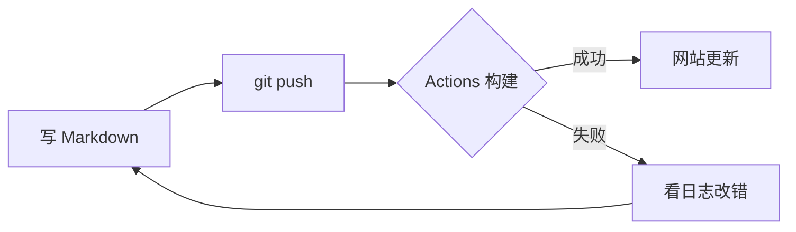

## 欢迎

这是第一篇文章。把 `_posts/` 目录下的这个文件改掉或者删掉，就可以开始写你自己的内容了。

> 提示：文章文件名必须是 `YYYY-MM-DD-标题.md` 的格式，否则 Jekyll 不会把它当成文章。
> 标题用英文比较省事（会出现在 URL 里），想用中文也行，但 URL 会被编码成一长串 `%E4%BD%A0...`。
{: .prompt-tip }

## 标题与文本

这是正文。支持 **加粗**、*斜体*、~~删除线~~、`行内代码`，以及[链接](https://jekyllrb.com/)。

## 代码块

````markdown
```python
def fib(n: int) -> int:
    a, b = 0, 1
    for _ in range(n):
        a, b = b, a + b
    return a
```
````

渲染出来是带行号和高亮的：

```python
def fib(n: int) -> int:
    a, b = 0, 1
    for _ in range(n):
        a, b = b, a + b
    return a


print([fib(i) for i in range(10)])
```

指定 `{: .filepath}` 之类的 class 还能做出 Chirpy 特有的提示样式：

```yaml
title: 我的博客
timezone: Asia/Shanghai
```
{: file="_config.yml" }

## 列表与表格

1. 第一项
2. 第二项
   - 嵌套的无序列表

| 命令 | 作用 |
| :--- | :--- |
| `bundle exec jekyll s -l` | 本地预览（支持实时刷新） |
| `bundle exec jekyll b` | 构建生产版本到 `_site/` |

## 提示框（Chirpy 专有语法）

> 这是一条普通引用。

> 这是一条提示。
{: .prompt-tip }

> 这是一条信息。
{: .prompt-info }

> 这是一条警告。
{: .prompt-warning }

> 这是一条危险提示。
{: .prompt-danger }

## 数学公式

Front matter 里写 `math: true` 之后就可以用 LaTeX：

行内公式：$E = mc^2$

块级公式：

$$
\int_{-\infty}^{\infty} e^{-x^2}\,\mathrm{d}x = \sqrt{\pi}
$$

## 流程图

Front matter 里写 `mermaid: true`：



## 图片

图片放在 `assets/img/` 下（需要自己建目录），然后这样引用：

```markdown

```

如果需要更细致的排版，可以直接写 HTML：

```html
<p class="text-center">
  
</p>
```

## 脚注

Chirpy 支持脚注[^1]，写法是 `[^1]`。

[^1]: 这是脚注的内容。

## 折叠内容

<details>
<summary>点我展开</summary>

这里是被折叠的内容，可以是任意 Markdown 或 HTML。

</details>

## 下一步

- 去改 `_config.yml` 里的标题、作者、头像
- 去改 `_tabs/about.md` 写"关于"页
- 把这篇文章删掉或者改名，开始写真正的内容
